# Kiến trúc Teams Chatbot Orchestrator

Tài liệu này mô tả **kiến trúc đang được hiện thực trong repository**. Hệ thống là một prototype điều phối chatbot nội bộ: nhận một hội thoại duy nhất từ người dùng, dùng Qwen để hiểu và định tuyến yêu cầu, rồi trả lời trực tiếp hoặc chuyển yêu cầu tới một Dify agent chuyên môn.

## 1. Toàn cảnh hệ thống

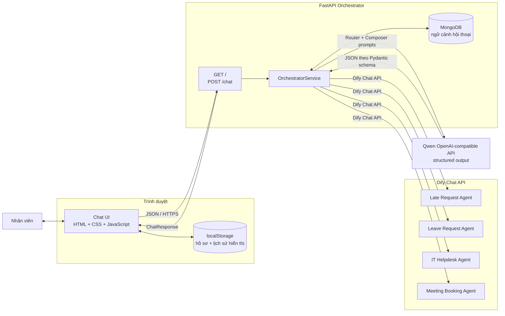

### Trách nhiệm theo biên hệ thống

| Khối | Trách nhiệm chính |
|---|---|
| Chat UI | Lưu hồ sơ và lịch sử hiển thị ở trình duyệt; gửi tin nhắn; hiển thị trace Router/Composer. |
| FastAPI | Phục vụ static UI, kiểm tra request/response bằng Pydantic và quản lý vòng đời ứng dụng. |
| Orchestrator | Tuần tự hóa request theo cuộc hội thoại, định tuyến, soạn request cho bot và cập nhật hai loại lịch sử. |
| Qwen | Sinh kết quả có cấu trúc cho `RouterDecision` và `ComposedRequest`; không trực tiếp gọi Dify. |
| Dify agents | Thực thi nghiệp vụ chuyên môn và duy trì `conversation_id` riêng của từng agent. |

## 2. Kiến trúc thành phần backend

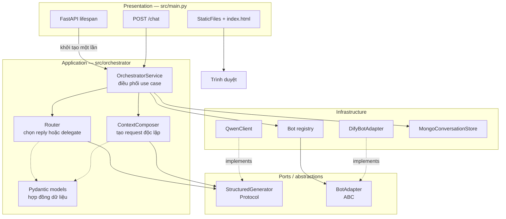

Các dependency được ghép trong `create_service()`:

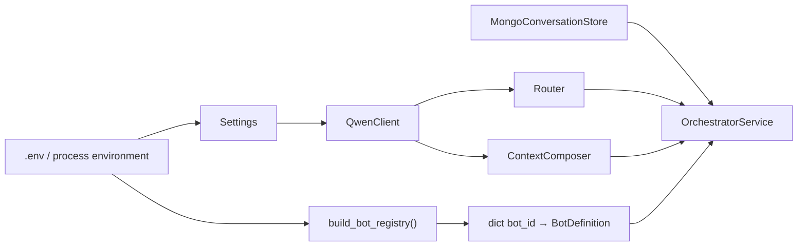

Việc phụ thuộc vào `StructuredGenerator` và `BotAdapter` giúp test thay Qwen/Dify thật bằng `FakeLLM` và `MockBotAdapter` mà không đổi logic orchestration.

## 3. Luồng xử lý một tin nhắn

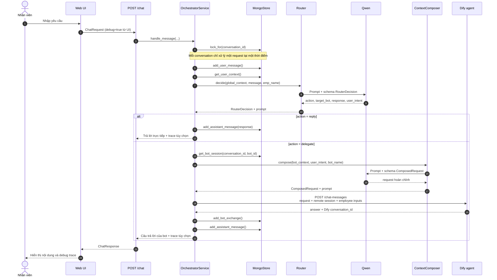

### Vai trò của hai bước LLM

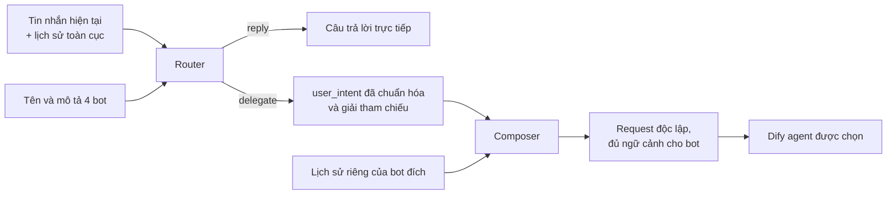

- **Router** nhìn toàn bộ hội thoại người dùng ↔ orchestrator. Nó chọn bot theo ý nghĩa, có thể hỏi làm rõ, và phải giải các tham chiếu liên bot trước khi tạo `user_intent`.
- **Composer** chỉ nhìn `user_intent` cùng lịch sử của bot đích. Nó bổ sung thông tin bot đang chờ nhưng không được đổi ý định, tự trả lời hay bịa dữ kiện.
- Với nhánh `reply`, hệ thống gọi Qwen một lần. Với nhánh `delegate`, hệ thống gọi Qwen hai lần rồi gọi một Dify agent.

## 4. Mô hình ngữ cảnh và phiên

Hệ thống cố ý duy trì hai lớp lịch sử khác nhau:

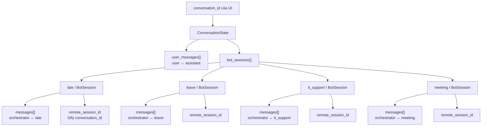

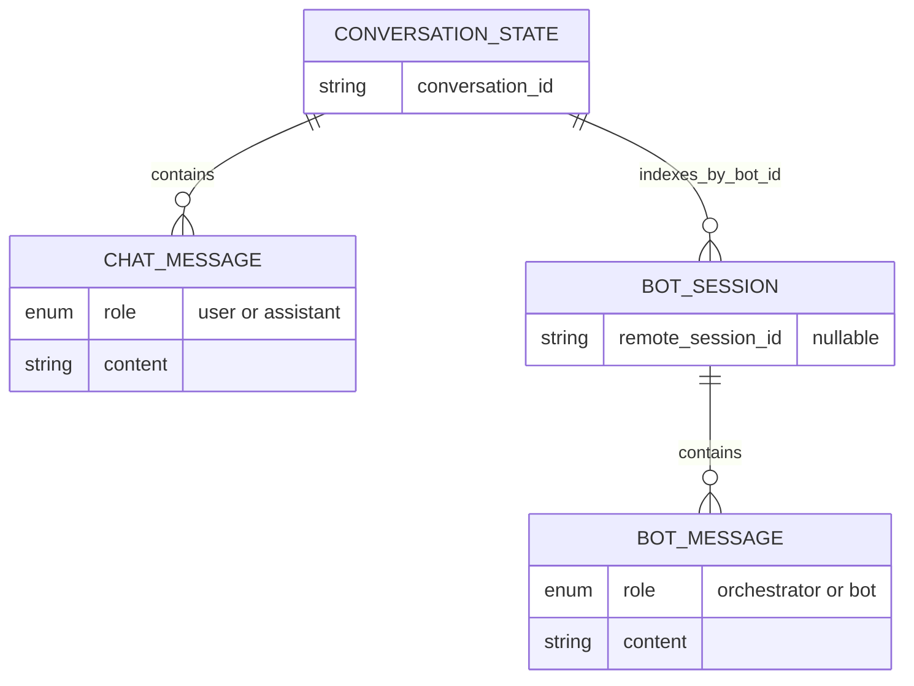

| Ngữ cảnh | Consumer | Mục đích |
|---|---|---|
| `user_messages` | Router | Hiểu diễn tiến toàn cuộc trò chuyện, kể cả khi người dùng chuyển nghiệp vụ giữa các bot. |
| `bot_sessions[bot_id].messages` | Composer | Tiếp tục đúng tác vụ của riêng bot được chọn và không đưa lịch sử bot khác sang. |
| `bot_sessions[bot_id].remote_session_id` | Dify adapter | Nối tiếp đúng conversation trên Dify cho từng bot. |
| `localStorage` của UI | Trình duyệt | Khôi phục hồ sơ và tin nhắn hiển thị sau khi tải lại trang; không phải nguồn ngữ cảnh backend. |

Khóa `asyncio.Lock` cũng được tách theo `conversation_id`:

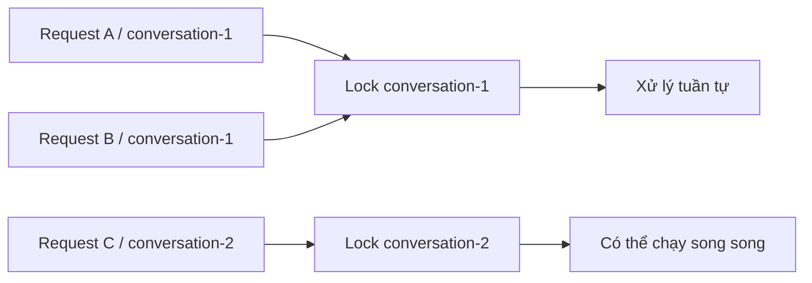

## 5. Registry và tích hợp Dify

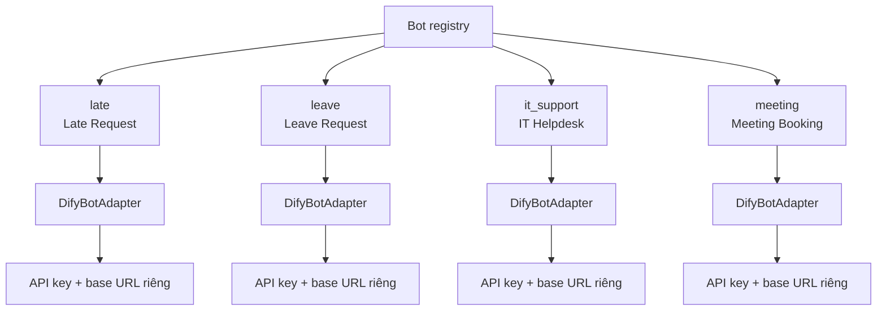

Adapter gửi payload theo Dify Chat API:

```json
{
  "inputs": {
    "emp_id": "E001",
    "emp_name": "Nguyễn Văn An"
  },
  "query": "Yêu cầu đã được Composer hoàn chỉnh",
  "response_mode": "streaming",
  "conversation_id": "phiên Dify trước đó hoặc chuỗi rỗng",
  "user": "user_id"
}
```

Adapter hiểu cả phản hồi JSON thông thường và SSE. Với SSE, nó ghép các event `message`/`agent_message`, thay toàn bộ nội dung khi nhận `message_replace`, và cập nhật `conversation_id`. Tuy payload yêu cầu chế độ `streaming`, backend hiện đợi toàn bộ HTTP response rồi mới phân tích và trả về UI; chưa relay token theo thời gian thực tới trình duyệt.

## 6. Hợp đồng API và trace

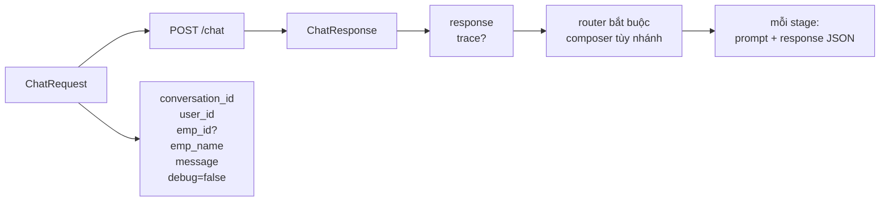

- Pydantic từ chối các chuỗi bắt buộc rỗng và kiểm tra tính nhất quán của `RouterDecision`.
- Khi `debug=false`, service chỉ trả nội dung; khi `debug=true`, response có cả prompt và structured response của Router/Composer.
- UI hiện luôn gửi `debug=true` và cho phép xem/copy trace trong drawer “Luồng xử lý”. Vì prompt có lịch sử và dữ liệu nhân viên, không nên bật cơ chế này cho người dùng production nếu chưa có kiểm soát truy cập và che dữ liệu nhạy cảm.

## 7. Khởi động và cấu hình

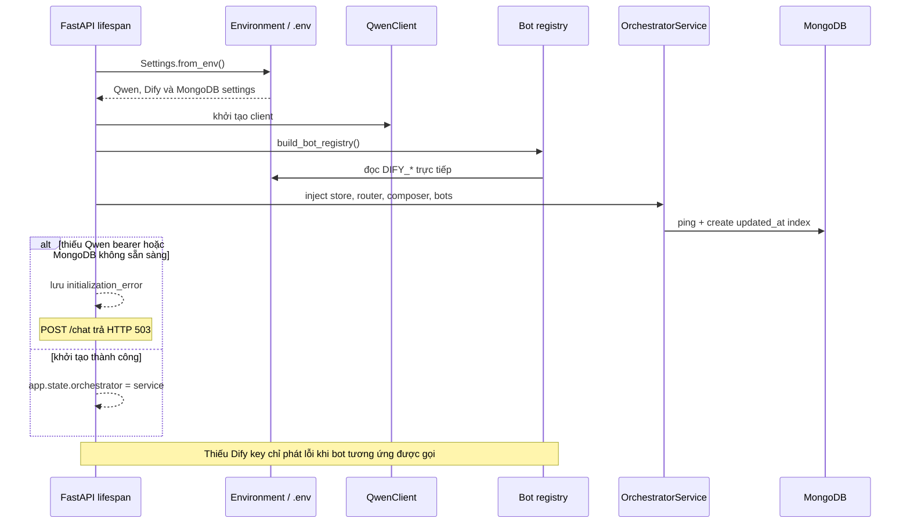

Các nhóm biến môi trường:

| Nhóm | Biến |
|---|---|
| Qwen | `QWEN_BASE_URL`, `QWEN_BEARER`, `QWEN_MODEL`, `QWEN_MAX_TOKENS`, `QWEN_TIMEOUT_SECONDS` |
| Dify dùng chung | `DIFY_BASE_URL` |
| Dify từng bot | `DIFY_LATE_REQUEST_*`, `DIFY_LEAVE_REQUEST_*`, `DIFY_IT_HELPDESK_*`, `DIFY_MEETING_BOOKING_*` |
| MongoDB | `MONGODB_URI`, `MONGODB_DATABASE`, `MONGODB_COLLECTION`, `MONGODB_SERVER_SELECTION_TIMEOUT_MS` |

Mỗi bot có API key riêng. Base URL riêng của bot được ưu tiên hơn `DIFY_BASE_URL`, nên bốn bot có thể nằm trên các Dify server khác nhau.

## 8. Cấu trúc mã nguồn

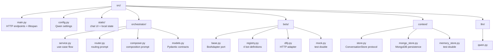

## 9. Đặc tính vận hành hiện tại

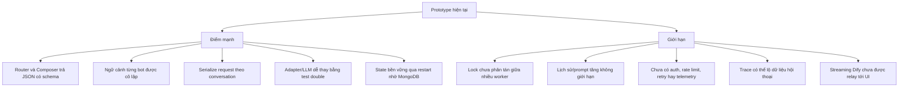

Lưu ý quan trọng:

1. **State nằm trong MongoDB, nhưng lock vẫn nằm trong process.** Restart ứng dụng không làm mất ngữ cảnh backend. Image Docker chạy một Uvicorn worker; nếu scale nhiều worker/replica thì cần distributed lock để tránh hai lượt của cùng một `conversation_id` chạy đồng thời.
2. **Hồ sơ UI chưa phải xác thực.** `emp_id`, `emp_name` và `user_id` do trình duyệt gửi lên, chưa được đối chiếu với một identity provider.
3. **Không có chính sách cắt lịch sử.** Cả prompt Router lẫn lịch sử bot có thể tăng dần theo số lượt chat, làm tăng độ trễ và chi phí token.
4. **Lỗi downstream truyền thành lỗi server.** Adapter có thông báo lỗi rõ ở tầng Python và endpoint ánh xạ lỗi Qwen/Dify thành HTTP 502; chưa có retry có kiểm soát.

## 10. Hướng mở rộng đề xuất

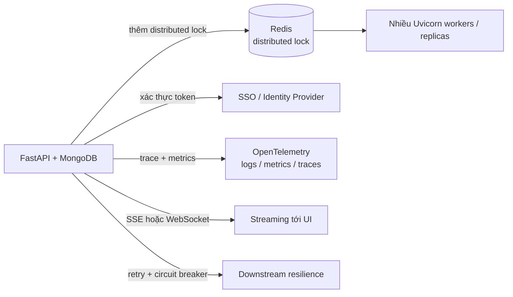

Thứ tự ưu tiên hợp lý khi đưa prototype lên production:

1. Thêm xác thực và lấy thông tin nhân viên từ danh tính tin cậy thay vì request body.
2. Thêm distributed lock nếu cần chạy nhiều Uvicorn worker hoặc nhiều replica.
3. Tắt/giới hạn debug trace; bổ sung masking cho PII và secrets.
4. Giới hạn hoặc tóm tắt lịch sử; đặt timeout, retry có backoff và circuit breaker cho dịch vụ ngoài.
5. Bổ sung observability theo `conversation_id`, nhưng không ghi nguyên prompt chứa dữ liệu nhạy cảm.
6. Nếu cần trải nghiệm realtime, relay SSE từ Dify qua FastAPI đến UI.

## 11. Phạm vi kiểm thử hiện có

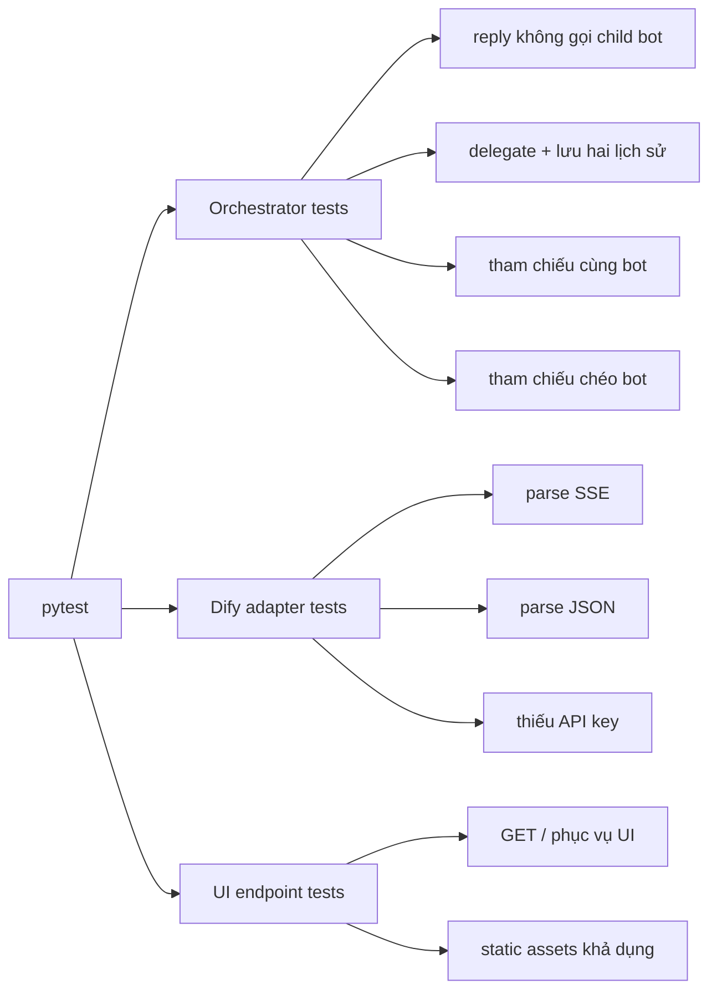

Các test dùng fake LLM và mock HTTP transport, vì vậy không gọi Qwen/Dify thật và không cần API key.
